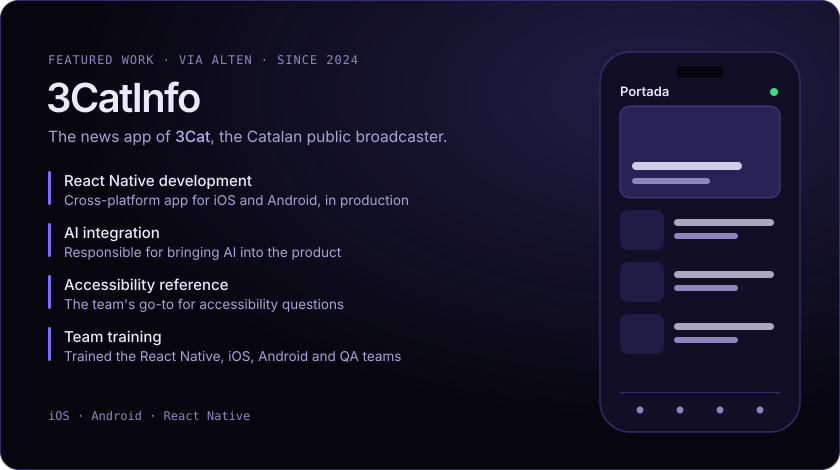
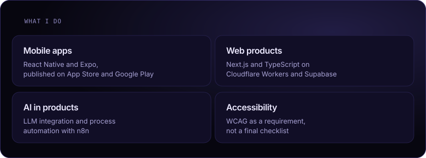
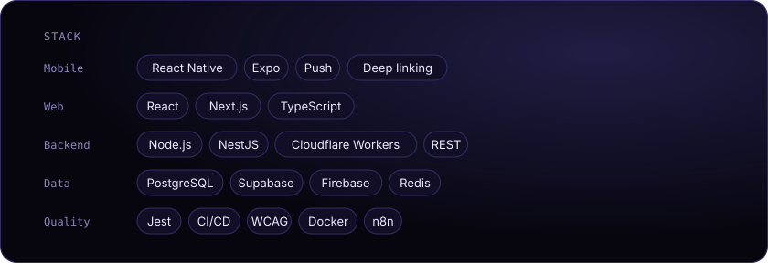

  

  

  
  &nbsp;
  

  

  

  
  &nbsp;
  

Also building: <b>Oportunix</b>, a mystery box marketplace with automated operations (Next.js, Firebase), and <b>HazmeFila</b>, an app to hire someone who queues for you (Expo, Supabase). Client work lives in private repositories.

<b>En español.</b> Desarrollador React Native y full-stack en Leganés (Madrid). Apps en producción, IA dentro del producto y accesibilidad desde la primera pantalla. Disponible para proyectos freelance por horas o a precio cerrado.

